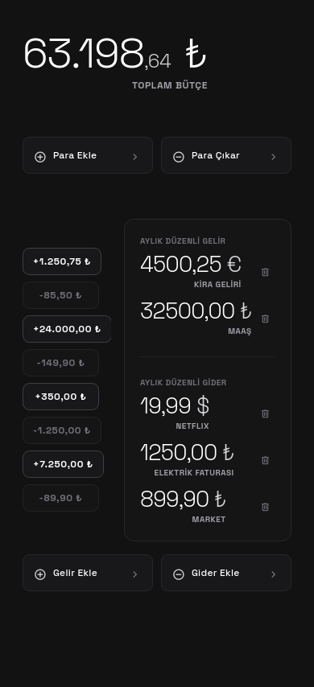
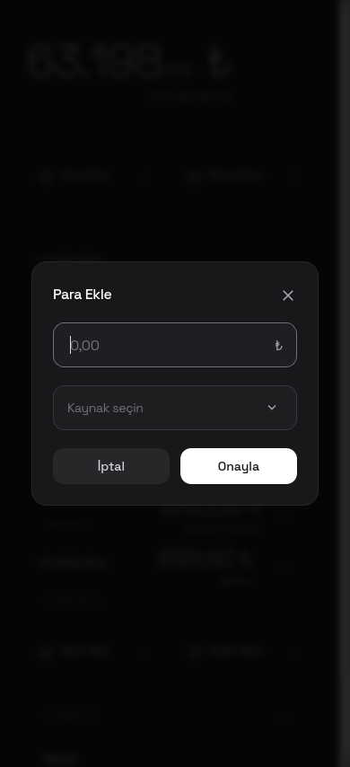
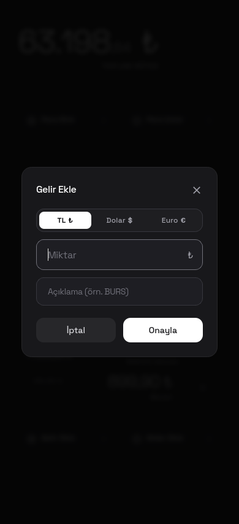

#  BUTAS — Tek Ekran Bütçe Takibi (Qt Widgets / C++)

Tek ekranlı mobil bütçe takip uygulaması. Qt 6 Widgets ile saf C++ olarak
geliştirilmiştir. Tasarım ve davranış orijinal HTML prototipine birebir
sadıktır: renk ölçeği (zinc-*), yuvarlama yarıçapları, harf aralığı
(letter-spacing) ve iş akışı aynen korunmuştur.

## Ekran Görüntüleri

| Ana Ekran | Para Ekle | Gelir Ekle |
|---|---|---|
|  |  |  |

## İndirme

Derlenmiş Android APK için [Releases](../../releases/latest) sayfasını
kullanın. En güncel sürüm: **v1.0**.

- `butas-v1.0.apk` — imzalı, arm64-v8a, minSdk 23, targetSdk 34
- SHA-256: `7ed5d9142aa46a4122a3c1409d2ebc9f062266e4c5bdc3bb62c4380c07ba96bc`

Kurulum: APK'yı telefona kopyalayıp dokunun, "Bilinmeyen kaynaklara izin ver"
isteğini onaylayın. USB ile: `adb install -r butas-v1.0.apk`

## Ekranlar / İşlevler

- **Toplam Bütçe:** Üstte büyük yazıyla gösterilir (ör. "63.198,64 ₺";
  negatifse "-" öneki ile).
- **Para Ekle / Para Çıkar:** Açılan modal'da tutar girilir (₺ son eki).
  Onayla ile bütçe güncellenir ve işlem listesinin başına eklenir.
  En fazla 10 işlem tutulur (en yeni başta).
  Enter = onayla, Escape = kapat, arka plana tıklama = kapat.
- **Aylık Düzenli Gelir/Gider Paneli:** Gelir Ekle / Gider Ekle modal'ı.
  Döviz seçimi (TL ₺ / Dolar $ / Euro €). Miktar + Açıklama.
  Sil (çöp ikonu) → "Silme İşlemi" onay modalı.
- **Animasyonlar:** Modal açılış/kapanış — 200 ms soluklaşma + ölçek
  animasyonu, arka plan bulanıklaştırma (box-blur).
- **Uygulama İkonu:** Kömür grisi zemin, Space Grotesk Bold beyaz **BTA**
  (adaptive icon + tüm yoğunluklar).
- **Kalıcılık:** Bakiye, son işlemler ve aylık düzenli gelir/giderler
  uygulama kapanıp açıldığında korunur (`state.json`).
  İlk açılışta bakiye `0,00 ₺` olarak başlar, listeler boştur.
- **Kaydırma:** Kopyalanma/üst üste binme olmaması için sayfa her
  kaydırma adımında tamamen yeniden çizilir.

## Derleme (Masaüstü)

Qt 6.x (6.2+) Widgets kurulu olmalı.

```bash
cmake -B build -DCMAKE_BUILD_TYPE=Release
cmake --build build
./build/butas
```

Pencere 390×854 açılır (mobil görünüm genişliği).

## Android APK

### Gereksinimler

- Qt 6.7+ masaüstü (host araçları) + Qt 6.7+ Android arm64_v8a
- JDK 17, Android SDK (platform 34, build-tools 34.0.0)
- NDK 26.x, Gradle 8.x

### Derleme

`build_apk.sh` betiği ile:

```bash
./scripts/build_apk.sh
```

Farklı bir kurulum kullanıyorsanız yolları elle verebilirsiniz:

```bash
QT_HOST=/yol/Qt/6.7.3/gcc_64 \
QT_ANDROID=/yol/Qt/6.7.3/android_arm64_v8a \
ANDROID_SDK_ROOT=/yol/Android/Sdk \
ANDROID_NDK_ROOT=/yol/Android/Sdk/ndk/26.1.10909125 \
JAVA_HOME=/yol/jdk17 \
GRADLE_BIN=/yol/gradle-8.3/bin \
BUILD_DIR=/yol/build \
./scripts/build_apk.sh
```

### APK İmzalama

```bash
zipalign -f -p 4 <imzasız-apk-yolu> aligned.apk
apksigner sign --ks /BUTAS/keys/butas.keystore --out butas-v1.0.apk aligned.apk
```

Keystore proje klasörünün dışında, `/BUTAS/keys/` altında tutulur
ve asla reposuna (GitHub'a) gönderilmez.

### Telefona Kurulum

1. APK'yı telefona kopyala (USB / bulut / e-posta).
2. Telefonda dosyaya dokun; "Bilinmeyen kaynaklara izin ver" isteğini onayla.
3. Kurulum biter, uygulama listesinde **BUTAS** olarak görünür.

USB ile: `adb install -r butas-v1.0.apk`

### Android'e Özgü Uyarlamalar

- Pencere, cihazın kullanılabilir ekran alanına sığdırılır; tasarımdaki
  tüm dp değerleri aynı kalır.
- İçerik ekrana sığmadığında sayfa kaydırılabilir. Dokunarak kaydırma
  (QScroller) etkindir.
- "Lastik bant" (overshoot) efekti kapalıdır: `QEvent::Scroll` doğrudan
  işlenir, viewport hiç taşınmaz.

### Notlar

- Uygulama adı ve paket adı `android/AndroidManifest.xml` ve
  `CMakeLists.txt` içindeki `QT_ANDROID_*` özellikleriyle belirlenir.
- Uygulama ikonu `android/res/mipmap-*` altındadır.
  Yeniden üretmek için: `python3 scripts/generate_icon.py` (Pillow gerekir).
- Kalıcı veri `state.json`, `QStandardPaths::AppDataLocation` dizininde
  tutulur.
- Kotlin/Java kodu yok; Qt etkinliği (`QtActivity`) doğrudan kullanılır.
- Fontlar qrc ile APK'ya gömülür, internet gerekmez.

## Fontlar (Paketlenmiş)

`app/assets/fonts/`:

- `SpaceGrotesk.ttf` — gövde/başlık fontu (Google Fonts, OFL).
- `MaterialSymbolsOutlined.ttf` — ikonlar (Google Fonts, OFL).

## Test / Ekran Görüntüsü Ortam Değişkenleri

| Değişken            | Anlamı                                                           |
|---------------------|------------------------------------------------------------------|
| `BUTAS_SHOT=x.png`  | Ekranı (390×854) x.png olarak kaydeder, sonra kapanır           |
| `BUTAS_MODAL=1..5`  | `BUTAS_SHOT` ile: 1–5 arası modal'ı açık gösterir               |
| `BUTAS_TEST=1`      | Test akışını çalıştırır, sonucu stdout'a yazar, kapanır         |
| `BUTAS_PERSIST=1`   | `BUTAS_TEST=1` iken kalıcı durum dosyasını okur/yazar           |
| `BUTAS_DUMP=yol`    | Durum dökümünü dosyaya ekler                                    |

```bash
QT_QPA_PLATFORM=offscreen BUTAS_TEST=1 ./build/butas
QT_QPA_PLATFORM=offscreen BUTAS_SHOT=s.png BUTAS_MODAL=3 ./build/butas
```

## Dosya Düzeni

```
butas/
├─ CMakeLists.txt
├─ VERSION
├─ README.md
├─ CHANGELOG.md
├─ LICENSE                      # MIT
├─ THIRD_PARTY_NOTICES.md       # font ve Qt bildirimleri
├─ docs/                        # README görselleri (ikon + ekran görüntüleri)
├─ android/                     # özel manifest + uygulama ikonu (res/)
├─ scripts/                     # build_apk.sh, generate_icon.py
├─ app/
│  ├─ resources.qrc
│  ├─ assets/fonts/             # gömülü TTF'ler
│  └─ src/
│     ├─ main.cpp               # font yükleme + pencere + test bağlamları
│     ├─ mainwindow.h           # tüm durum + iş akışı erişimcileri
│     ├─ widgets.h              # ActionButton, BalanceWidget, ChipsList...
│     ├─ panel.h                # sağ panel (aylık düzenli gelir/gider)
│     ├─ modals.h               # modal katmanı: bulanıklaştırma + animasyon
│     ├─ modal_boxes.h          # 3 modal içeriği
│     ├─ linedit.h              # CSS'ten yeniden üretilen QLineEdit
│     ├─ theme.h                # renkler / fontlar / harf aralığı / ikon kodları
│     ├─ blur.h                 # arka plan bulanıklaştırma
│     ├─ format.h               # sayı biçimlendirme (Türkçe yerel ayar)
│     └─ icons.h                # Material Symbols çizim yardımcıları
```

## Lisans

Kaynak kod [MIT Lisansı](LICENSE) ile lisanslanmıştır.
Copyright (c) 2026 Ahmet E. Özdağ.

Paketlenen fontlar ve Qt bileşenleri kendi lisanslarına tabidir; ayrıntılar
için [THIRD_PARTY_NOTICES.md](THIRD_PARTY_NOTICES.md) dosyasına bakın.
